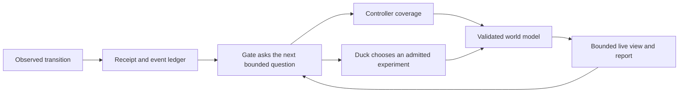

# Virelai / Cybernetic Duck

An open research prototype for building an **evidence-backed internal model of an unfamiliar interactive world**.

Virelai was developed for ARC-AGI-3. Its main idea is to split exploration between:

- a deterministic controller that performs routine coverage and records exact receipts;
- a language model (“Duck”) that chooses among admitted experiments when judgment is useful; and
- a persistent semantic library that keeps observations, unresolved questions, provenance, and bounded claims.

This repository is now a community research release. It contains the complete development history, test fixtures,
Kaggle packaging work, failed approaches, and the current Ring 9 implementation.

> **Status, 27 October 2026:** research prototype, released for discussion and reuse. We are not claiming a new
> state of the art result or a complete scientific paper. The strongest contribution is the architecture and its
> unusually explicit evidence discipline.

## The idea

Most tool-using agents compress a world into prompt history or informal notes. Virelai instead treats world learning
as a sequence of typed, auditable studies:



The current gate ladder asks:

1. **G1 — control:** what does the agent directly control?
2. **G2 — counter:** which changes are global or automatic rather than caused by the chosen action?
3. **G3 — inventory:** which objects behave like levers or other interactive entities?
4. **G4 — mechanics:** what does each lever affect, what states does it occupy, and what persists or reverses?

The resulting library stores observational nouns and verbs, transformation patterns, per-lever dossiers, provenance,
open questions, and observed level-clear episodes. Claims remain separate from their evidence and from the actor who
proposed them.

## What is implemented

- A schema-v11 `world_model.json` with strict validation and deterministic hashing.
- Transition receipts, audit journals, typed gaps, provenance reconciliation, and fail-closed readers.
- Conservative object continuity with unresolved joins kept visible.
- Nine observational transformation verbs and folded mirror events.
- Per-lever anatomy, orbit, limits, relation, and law chapters.
- Library-directed experiment selection with deterministic controller fallback.
- Bounded recovery when Duck times out, declines, or fails to act.
- Human-readable world reports and compact model-facing digests.
- Offline claim projection, answer-key mapping, and five-category grading tools.
- An exact acceptance snapshot of **1,487 tests**; the latest Mac run passed **1,486 with 1 skipped**.

## Honest limits

- The system does not yet demonstrate reliable general puzzle solving or a state of the art benchmark result.
- Several worlds remain only partly characterized; a sealed model can honestly contain unresolved mechanics.
- The public-25 runs and later canaries were primarily instrumentation and runtime tests, not a controlled efficacy
  study. Two final Kaggle canary attempts failed before notebook execution because the platform returned an empty
  infrastructure error.
- Human-authored grading keys and a preregistered 25-world evidence run were designed but not completed.
- The repository preserves many dated plans and superseded implementations. They are useful research history, but the
  active source is the Ring 9 tree below.

## Start exploring

| Area | Path |
| --- | --- |
| Active solver | [`variants/ring9-cybernetic-gates/ARC3-Inference/`](variants/ring9-cybernetic-gates/ARC3-Inference/) |
| Semantic world model | [`inference/framework/world_model_v2.py`](variants/ring9-cybernetic-gates/ARC3-Inference/inference/framework/world_model_v2.py) |
| Gates and controller | [`inference/framework/virelai_gates.py`](variants/ring9-cybernetic-gates/ARC3-Inference/inference/framework/virelai_gates.py) |
| World description | [`inference/framework/world_description.py`](variants/ring9-cybernetic-gates/ARC3-Inference/inference/framework/world_description.py) |
| Lever dossiers | [`inference/framework/lever_dossiers.py`](variants/ring9-cybernetic-gates/ARC3-Inference/inference/framework/lever_dossiers.py) |
| Provenance | [`inference/framework/audit_journal.py`](variants/ring9-cybernetic-gates/ARC3-Inference/inference/framework/audit_journal.py) |
| Paper evidence tools | [`inference/paper_evidence/`](variants/ring9-cybernetic-gates/ARC3-Inference/inference/paper_evidence/) |
| Current release note | [`PUBLIC_RELEASE_2026-10-27.md`](PUBLIC_RELEASE_2026-10-27.md) |
| Historical documentation | [`DOCUMENTATION_INDEX_2026-09-20.md`](DOCUMENTATION_INDEX_2026-09-20.md) |

## Run the tests

The active tree requires Python 3.12 and [`uv`](https://docs.astral.sh/uv/).

```bash
cd variants/ring9-cybernetic-gates/ARC3-Inference
uv sync --locked --extra dev
PYTHONPATH=.:tests:../tufa-arc-agi-framework/src \
  uv run --locked --extra dev python tools/test_tiers.py --check
```

The full acceptance run is intentionally large:

```bash
PYTHONPATH=.:tests:../tufa-arc-agi-framework/src \
  uv run --locked --extra dev python tools/test_tiers.py T2 --jobs 2
```

See the active tree's [README](variants/ring9-cybernetic-gates/ARC3-Inference/README.md) for model-server and gameplay
setup. A GPU and access to the ARC-AGI-3 environment are needed for live benchmark runs.

## Repository shape

- `baseline/` — frozen Tufa Labs Duck harness source.
- `variants/` — successive research rings; Ring 9 is current.
- `kaggle/` — historical and current notebook packages.
- `runs/` — committed run evidence where retained; most local run output is ignored.
- `handoff/` and dated root documents — decisions, interfaces, failures, and build history.

## Contributing

Discussion, replication, simplification, and critical review are welcome. Good starting questions are listed in
[`CONTRIBUTING.md`](CONTRIBUTING.md). Please distinguish an observed result from an interpretation, and attach the
receipt or fixture that supports any behavioral claim.

## License and attribution

Original Virelai work is released under **MIT-0**. The vendored Duck harness and derived variant files retain the
upstream **MIT** terms and Tufa Labs attribution. See [`LICENSE`](LICENSE) and
[`THIRD_PARTY_NOTICES.md`](THIRD_PARTY_NOTICES.md).
